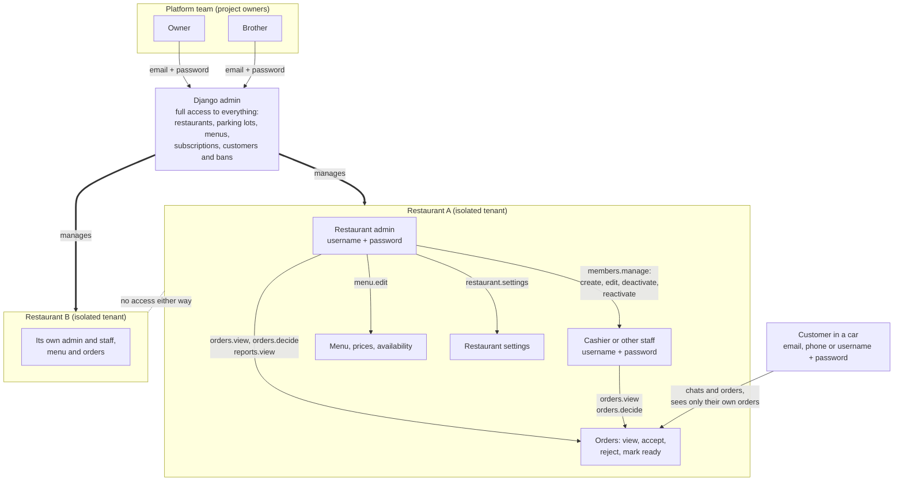
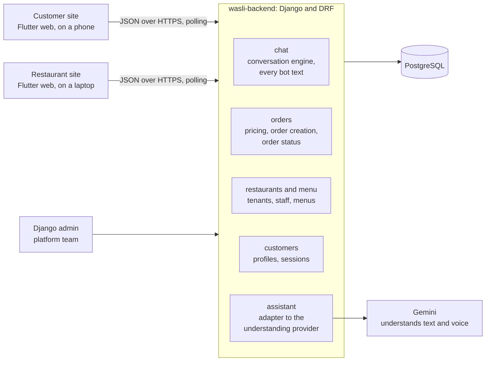
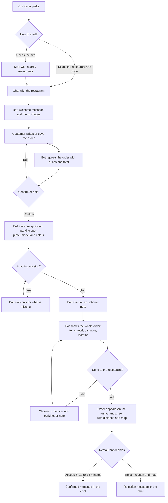
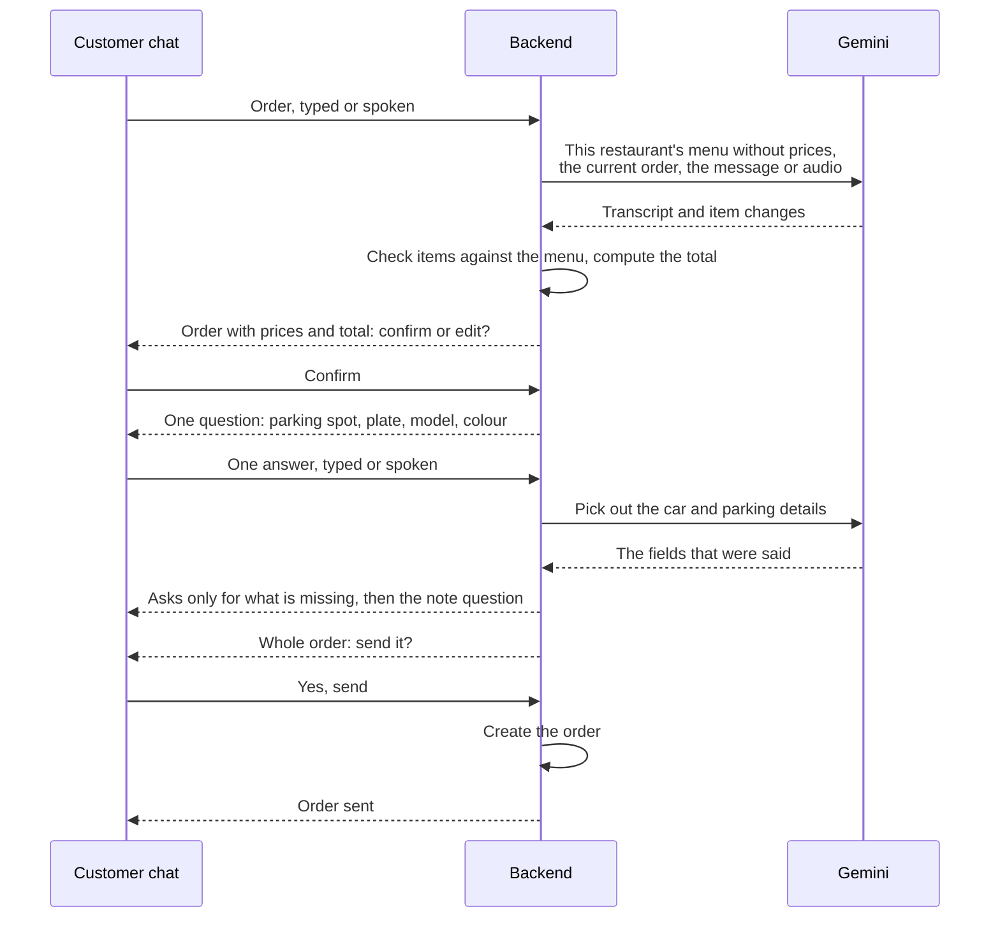
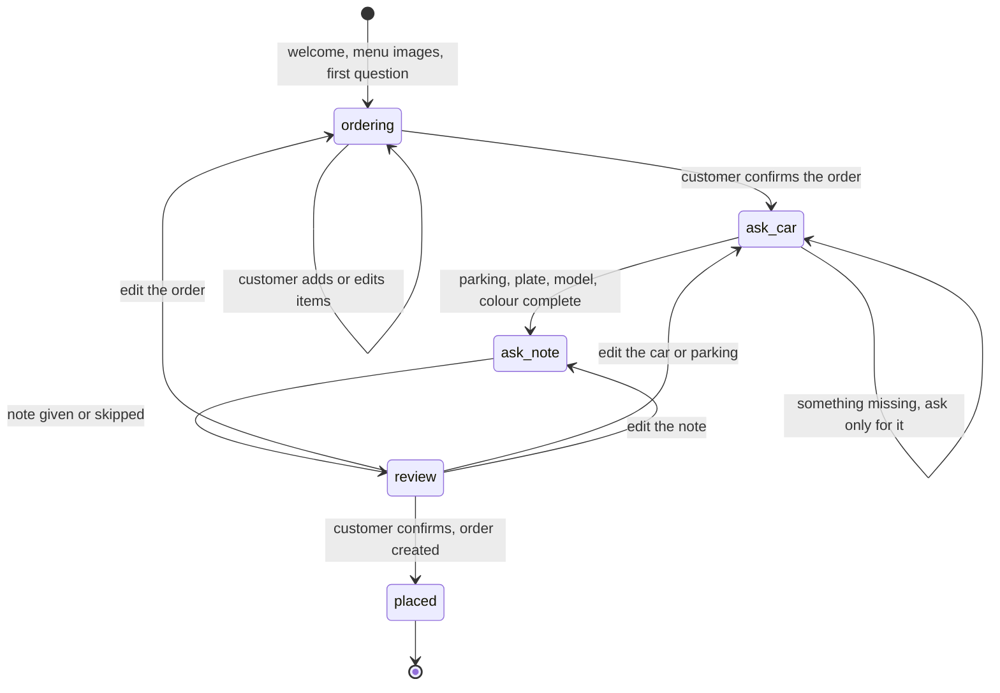
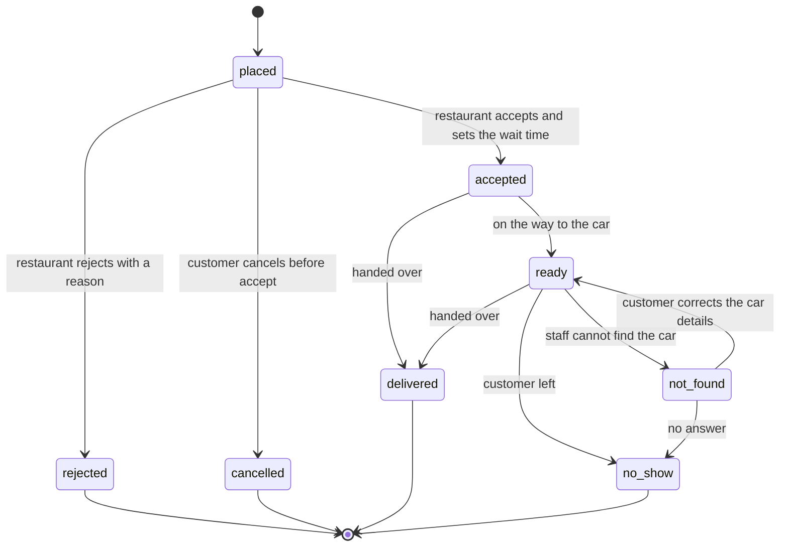
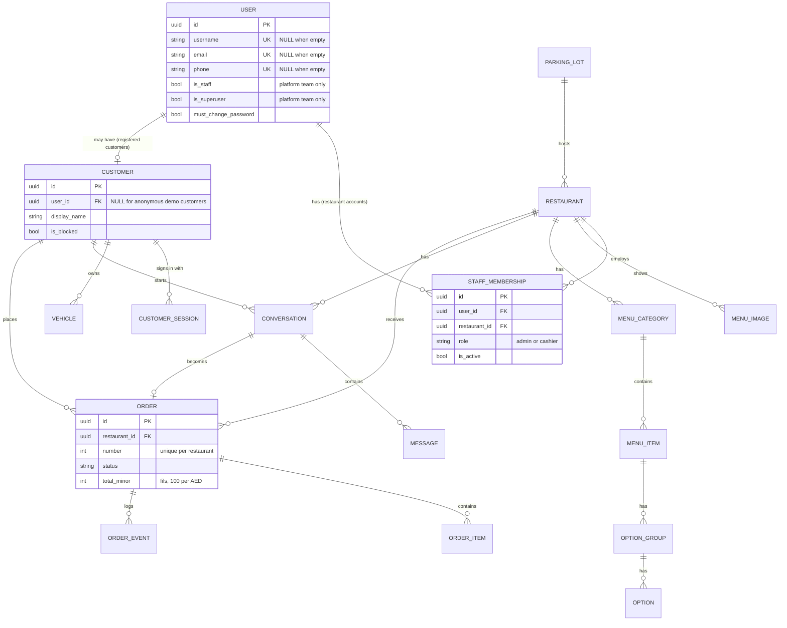

# Wasli: project overview

A high-level picture of what Wasli is, who uses it, how an order travels through it and how this repository is organised. Read it first; the detailed rules are in [`api-conventions.md`](api-conventions.md) and in the generated `openapi/schema.yaml` (the final truth for endpoints, committed with the first endpoint). The checklist of work is [`steps.md`](steps.md).

> **Status:** the repository holds the Django scaffold, the `users` app and the empty shells of the other apps (`core`, `restaurants`, `menu`, `customers`, `chat`, `orders`, `assistant`). Everything below that is not in `users` is the agreed design, built milestone by milestone (D0 to D4 for the demo, then the pilot).

## 1. What Wasli is

Customers parked at a restaurant or cafeteria order **from the car, without honking**. They open a map (or scan the restaurant's QR code), tap the restaurant and **chat with it**: the order is typed or spoken, repeated back with prices and confirmed. The bot then asks one question about the car and the parking spot and one for an optional note, shows the whole order and sends it after a final confirmation. The restaurant sees the order with the car, the parking spot and the customer's distance, **accepts** it with a wait time or **rejects** it with a reason, the answer appears in the same chat, and staff bring the order to the car.

Restaurants pay a flat monthly subscription, with no commission. Languages are Arabic and English (right to left for Arabic), currency AED.

## 2. Who uses it

| Who | Account | Can do |
| --- | --- | --- |
| Platform team | Superuser, signs in with email, uses Django admin | Everything: add, change or delete restaurants, menus, subscriptions, customers |
| Restaurant admin | `User` + membership with role `admin`, signs in with a username | Everything inside their own restaurant: menu, prices, settings, reports, orders, and their cashiers and other staff (create, edit, deactivate, reactivate). Never another restaurant |
| Cashier or other staff | `User` + membership with role `cashier`, signs in with a username | See orders, accept, reject, mark ready. Cannot change menu, prices, members or settings |
| Customer | `User` + a `Customer` profile (anonymous in the demo), signs in with email, phone or username | Chat with a restaurant, place and follow their own orders |

Every permission is a code checked on each request, never a role name: `orders.view`, `orders.decide`, `menu.edit`, `members.manage`, `restaurant.settings`, `reports.view`. An admin has all six, a cashier only the first two. A restaurant admin cannot grant more than their own role, and the last admin of a restaurant cannot be deactivated or demoted. Accounts are never deleted, because past orders point at the person who handled them: an admin deactivates a member (they can no longer sign in) and can reactivate them later.

## 3. The system at a glance

- The two sites are separate Flutter apps in the sibling repository. They generate their API client from this repository's `openapi/schema.yaml`.
- The demo runs on free plans: the API on Render, the database on Neon, the two sites on Cloudflare Pages. There are two environments: `develop` is staging (its own Render service and Neon project) and `main` is production (its own Render service and Neon project). Local development and tests also use the staging Neon project directly, with no local database. Everything in the demo stays on free plans. The product moves to paid always-on hosting without changing the data model or the API.
- In the demo the sites poll every 3 seconds. The product replaces polling with a realtime stream and adds notifications, payments and phone verification.

## 4. How an order works

### Who understands, who decides

The backend decides every next step, **writes every message** in the customer's language, checks items against the menu, calculates every price and creates the order. Gemini is called only to **understand** (the order, a yes or an edit, the car details inside one answer, voice) and never writes text, prices or orders. If it is unavailable the chat still works: the car questions are asked one at a time and an item picker builds the order.

### Conversation states

### Order status

The demo covers `placed`, `accepted` and `rejected` (`ready` is optional). The other statuses come with the pilot. Any other transition is refused with a `409` error.

## 5. How the data fits together

Rules that apply to every table:

- UUID primary key, plus `created_at` and `updated_at` in UTC.
- Money is an integer in fils, in fields named `*_minor`, with the currency `AED` alongside.
- Every restaurant-owned row has a `restaurant` foreign key, and every query is scoped by it. Staff of one restaurant can never read or change another's data.
- An order keeps **snapshots** of names, prices and the customer's answers, so later menu edits never rewrite history. Anything an order points at is protected from deletion.
- Customer-facing text comes in pairs (`name_en`, `name_ar`).

## 6. How this repository is organised

| App | Owns |
| --- | --- |
| `users` | The one account table (`User`): username, email, phone, password |
| `core` | Base model, restaurant scoping, permission codes and checks, money and distance helpers |
| `restaurants` | Parking lots, restaurants, menu images, staff memberships |
| `menu` | Categories, items, option groups, options |
| `customers` | Customer profiles, sessions and their authentication, vehicles, blocks |
| `chat` | Conversations, messages, the conversation engine and every bot text in Arabic and English |
| `orders` | Orders, order items, order events, pricing, order creation and status changes |
| `assistant` | The adapter to the understanding provider (Gemini first, a fake one in tests), prompts, call log |

Working rules:

- Views stay thin; business rules live in tested services (`chat/engine.py`, `orders/services.py`, `assistant/services.py`).
- The API is **contract first**: `openapi/schema.yaml` is generated, committed in the same pull request as the endpoint and never edited by hand.
- Tests never call the real provider.
- Work flows from a topic branch to a pull request into `develop`, then a release pull request into `main`; see [`api-workflow.md`](api-workflow.md).

## 7. Where the project is going

| Step | What it delivers |
| --- | --- |
| D0 | Setup, apps, settings, first deploy |
| D1 | Data model, restaurant and menu endpoints, seed with the first restaurant, the Gemini spike |
| D2 | The conversation engine: welcome to a placed order, by text and by voice |
| D3 | Restaurant side: staff login, orders list, accept and reject (**the demo is shown here**) |
| D4 | Polish: second restaurant, logs, README |
| Before the pilot | Restaurant-admin API (menu, prices, members), customer sign-up and sign-in, audit log, two-factor sign-in for the platform team |
| Pilot and launch | Phone verification, more order statuses, payments choice, realtime, notifications, mobile apps |

The exact checklist, with every step, is in [`steps.md`](steps.md).
